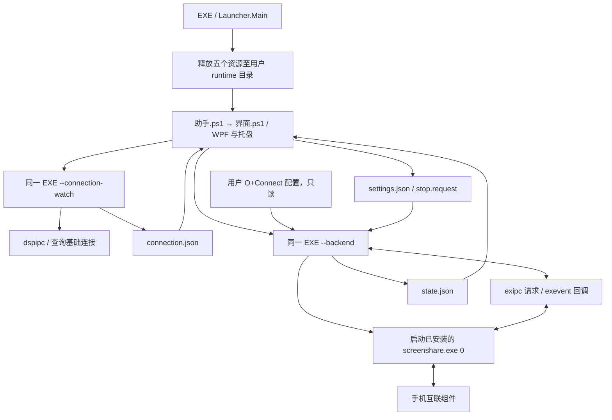

# OPPO Mouse Sharing · 键鼠共享助手

复用 OPPO 互联客户端的原生协同模块，为非大屏（折叠屏，平板 oppo设备）提供键鼠穿越功能。

> 本项目依赖客户端内部 IPC 接口；已验证客户端版本为 `16.2.20`。其他版本仍可尝试启用共享，如遇问题提交 issue。

## 功能

- 手机放在电脑左侧或右侧，从对应屏幕边缘进入手机。
- 首次靠边时建立共享，后续穿越复用已有连接。
- 分别显示基础互联连接状态与键鼠共享状态。
- 托盘中启停共享、切换方向、恢复窗口和退出。
- 保存方向与关闭窗口时的托盘偏好。
- 使用 C# 后端与 PowerShell/WPF 界面。

## 运行条件与兼容性

| 项目 | 已记录的验证环境 / 当前限制 |
| --- | --- |
| 电脑 | Windows 11 x64；其他 Windows 版本未验证 |
| 系统组件 | Windows PowerShell 5.1、.NET Framework 4.5 或更高版本及 WPF |
| PC 客户端 | 已验证 OPPO 互联 / O+Connect **16.2.20**；其他版本仅提醒，不按版本拦截 |
| 安装路径 | 固定为 `C:\Program Files\Oppo Connect` |
| 手机 | OPPO Find X9（PLJ110） |
| 手机系统 | Android 17 / ColorOS 17 |
| 手机互联组件 | `com.oplus.linker` 17.7.30 |

OPPO 互联客户端需要自行安装，并提前完成手机配对和基础连接。本仓库不附带客户端安装包、`screenshare.exe`、`app.asar`、手机 APK 或设备配置。
Oppo互联官网：[OPPO 互联 - OPPO一加手机平板与电脑、iPhone互联|官方下载](https://connect.oppo.com/#/)

## 使用

1. 打开 OPPO 互联，将电脑与手机正常连接，保持手机解锁。
2. 运行 `OPPO-Mouse-sharing.exe`。
3. 选择手机相对于电脑的“左侧”或“右侧”。
4. 点击“启用共享”，看到“等待穿越”后，将鼠标移向对应电脑屏幕边缘。
5. 按手机实际提示完成连接；从手机靠近电脑的一侧边缘返回。

切换方向前先将指针移回电脑。最小化到托盘后共享继续运行；双击托盘图标恢复，右键菜单可停止共享或退出。

## 代码结构与执行链路

```text
.
├── src/
│   ├── Launcher.cs       # 单文件入口、资源释放、后台模式调度
│   ├── Backend.cs        # IPC 传输、共享状态机、设备连接查询
│   └── app.manifest      # 当前用户权限、DPI 声明
├── 助手.ps1             # PowerShell 入口，转入界面脚本
├── 界面.ps1             # WPF 事件、托盘、偏好、子进程与状态刷新
├── main.xaml            # 主界面
├── close.xaml           # 关闭提醒
├── app.ico              # 与 assets/app-icon-green.png 对应的多尺寸图标
├── assets/              # 绿色图标 PNG 与来源说明
├── docs/                # 架构与执行链路说明
└── .github/             # Issue / PR 模板
```



共享采用两阶段建连：`armed` 等待边缘 → `cross_edge` 发起共享 → `onExSuccess` 进入 `ready`。鼠标后续穿越不会重复启动共享。详细进程生命周期、接口参数和停止流程见 [架构与执行链路](docs/ARCHITECTURE.md)。

## 数据与隐私

EXE 默认将资源和运行数据写入：

```text
%LOCALAPPDATA%\OPPO-Mouse-sharing\
├── runtime\<资源摘要>\   # 解压的界面脚本与资源
├── data\                 # settings.json、state.json、connection.json
├── validation-data\      # 离线自检数据目录
├── self-test.log          # 直接执行 EXE --self-test 时生成
└── launcher-error.log     # 启动异常时生成
```

界面异常日志在 `data/ui-error.log`；直接脚本运行则写入指定数据目录或脚本所在目录。助手读取 `%APPDATA%\O+Connect\config.json` 中当前设备信息，不修改原客户端配置。设备 ID 与 IP 用于本机 IPC 请求；实际电脑与手机间的输入传输由原模块完成。

本项目助手源码没有添加遥测或云端上传。该说明不涵盖 OPPO 客户端自身行为。请勿上传个人配置、设备 ID、IP、未脱敏日志或抓包；这些运行文件已加入 `.gitignore`。

## 常见问题

| 现象 | 检查方式 |
| --- | --- |
| 提示适配性未确认 | 当前客户端版本尚未验证，可以继续尝试；同一版本仅提醒一次，如遇问题请联系开发者或提交 Issue |
| 找不到客户端 | 确认固定安装路径及 `resources/app.asar`、`app_process/screenshare.exe` 存在 |
| 提示已有协同进程 | 先通过原客户端结束已有投屏/协同会话，再启用助手 |
| 连接未确认 | 确认客户端正在运行且手机已正常连接；该状态独立于共享状态 |
| 等待手机连接超时 | 解锁手机、处理手机端提示，重新连接客户端后重试 |
| 关闭后仍在运行 | 可能已最小化至托盘；右键托盘选择停止共享并退出 |
| 无法启动 | 查看 `launcher-error.log` 与数据目录下的 `ui-error.log`，提交前脱敏 |

## 参与贡献

见 [贡献指南](CONTRIBUTING.md) 和 [安全问题说明](SECURITY.md)。仓库仅公开应用源码、图标资源与必要文档。

## 许可证与名称

项目代码与文档采用 [MIT License](LICENSE)。`app.ico` 和 `assets/app-icon-green.png` 为客户端图标的绿色改色版本，不属于本项目 MIT 授权范围，原图标相关权利归原权利方。OPPO、OPlus、O+Connect 等名称用于说明兼容对象，MIT 许可不延伸至这些商标或原厂组件。详见 [NOTICE.md](NOTICE.md)。
