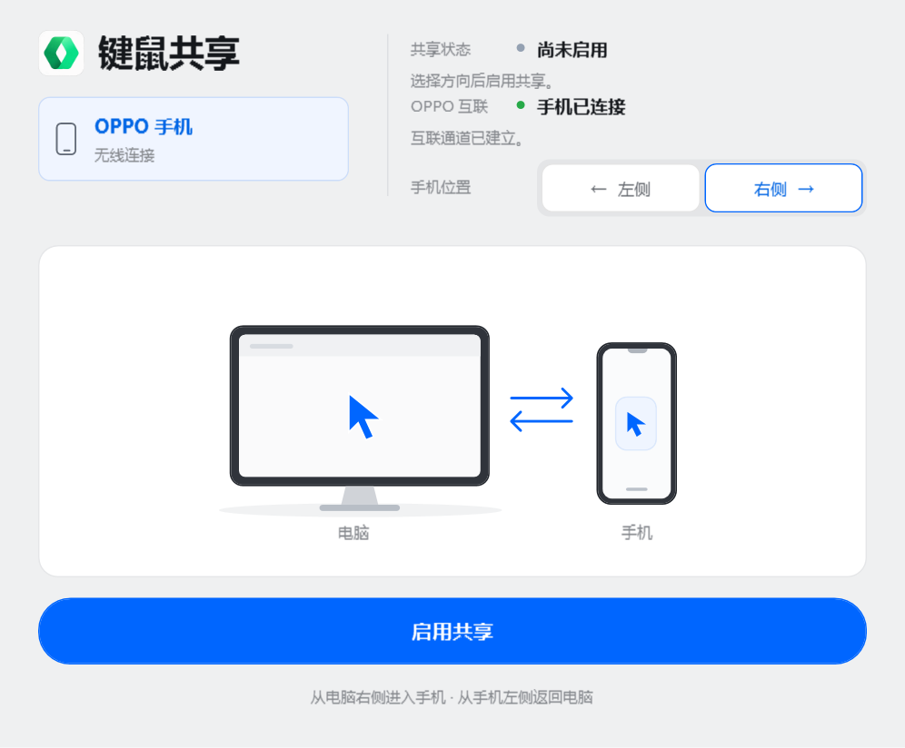
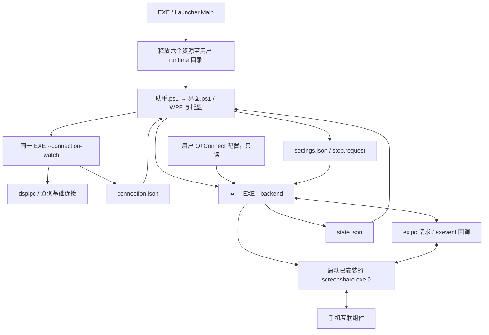

# OPPO Mouse Sharing · 键鼠共享助手

复用 OPPO 互联客户端的原生协同模块，为非大屏（折叠屏，平板 oppo设备）提供屏幕协同功能。

> 本项目依赖客户端内部 IPC 接口；低于 `17.100.10` 的版本使用旧版协同协议，`17.100.10` 及更高版本使用客户端 SDK。



## 功能

- 手机放在电脑左侧或右侧，从对应屏幕边缘进入手机。
- 首次靠边时建立共享，后续穿越复用已有连接。
- 分别显示基础互联连接状态与键鼠共享状态。
- 托盘中启停共享、打开新版协同页面、恢复窗口和退出。
- 保存方向与关闭窗口时的托盘偏好。
- 右上角设置中可开启开机自启动，登录 Windows 后在托盘中运行。
- 开启“连接设备后自动共享”后，在检测到设备连接时自动启用共享。
- 通过“打开 OPPO 互联屏幕协同设置”入口打开新版客户端的协同页面和设置。
- 使用 C# 后端与 PowerShell/WPF 界面。

## 运行条件与兼容性

| 项目 | 已记录的验证环境 / 当前限制 |
| --- | --- |
| 电脑 | Windows 11 x64；其他 Windows 版本未验证 |
| 系统组件 | Windows PowerShell 5.1、.NET Framework 4.5 或更高版本及 WPF |
| PC 客户端 | 低于 **17.100.10** 使用旧版后端；**17.100.10** 及以上使用 SDK 后端（需要先启用 SDK）。已验证版本为 16.2.20 和 17.100.10，其他版本启用共享时会显示兼容提示 |
| 安装路径 | 从当前用户正在运行的 `O+Connect.exe` 进程自动识别，支持其他盘符和自定义目录 |
| 手机 | OPPO Find X9（PLJ110） |
| 手机系统 | Android 17 / ColorOS 17 |
| 手机互联组件 | `com.oplus.linker` 17.7.30 |

OPPO 互联客户端需要自行安装，并提前完成手机配对和基础连接。本仓库不附带客户端安装包、`screenshare.exe`、`app.asar`、手机 APK 或设备配置。
Oppo互联官网：[OPPO 互联 - OPPO一加手机平板与电脑、iPhone互联|官方下载](https://connect.oppo.com/#/)

## 使用

1. 打开 OPPO 互联，将电脑与手机正常连接，保持手机解锁。
2. 运行 `OPPO-Mouse-sharing.exe`。
3. 选择手机相对于电脑的“左侧”或“右侧”。
4. 点击“启用共享”，看到“等待穿越”后，将鼠标移向对应电脑屏幕边缘。
5. 按手机实际提示完成连接；从手机靠近电脑的一侧边缘返回。

切换方向前先将指针移回电脑。最小化到托盘后共享继续运行；双击托盘图标恢复，右键菜单可停止共享或退出。

主页“启用共享”按钮上方可开启“连接设备后自动共享”。开启时设备已经连接也会生效；自动启用后仍按所选屏幕边缘穿越到手机。手动停止或启动失败后，同一次连接内不会反复自动启动，设备断开再连接时会重新尝试。关闭此开关不会停止正在进行的共享。开关默认关闭，偏好会保存。

右上角齿轮打开设置。“开机自启动”使用当前用户的 Windows 登录启动项，不需要管理员权限；开启后请保留 EXE 的存放位置，移动 EXE 后需在新位置重新开启。开机自启动与自动共享可分别设置。

新版客户端通过 SDK 获取手机连接及共享状态。点击“开始协同”或开启连接后自动共享后，助手会立即请求开始键鼠协同；需要调整设备排列时，在原厂屏幕协同页面操作。助手须保持运行（可最小化到托盘）。该功能要求客户端运行且恰好连接一台手机。OPPO 互联 17.100.10 的 SDK 受合作软件检测控制；在 AMD 机器上可以管理员权限创建 `HKLM\SOFTWARE\Classes\xiao-hui-oppo-mouse-sharing` 空注册表项以启用，删除该项会关闭 SDK（如果没有其他匹配项）。此行为依赖客户端内部实现，未来可能变化，也不是官方公开的第三方接入方式。Intel 机器的检测条件不同，尚未实机验证；步骤见设置中的使用帮助。旧版路径不需要此注册项。

新版共享成功后，助手读取原厂保存的当前手机排列，并在光标所在显示器的对应边缘短暂显示光效；配置不可读或方向未知时不会显示光效。该配置属于客户端内部实现，可能随版本变化。

在“设置 → 常规”中可手动检查更新。助手从本项目 GitHub Releases 查询最新正式版，API 请求受到限制时使用 GitHub 发布页面提供的信息；确认后下载并校验 SHA-256，然后退出、替换当前 EXE 并重新启动。助手启动的共享会在更新时停止；更新需要当前 EXE 所在目录的写入权限。下载校验依赖 GitHub 提供的摘要，用于检查完整性，并非发布者签名。

可在检查更新按钮左侧开启“自动检查”，默认关闭。开启后，助手启动时以及保持运行期间约每 24 小时在后台检查；发现新版本时，主页设置图标和检查更新按钮会显示红点。点击检查更新可查看说明并决定是否安装，后台检查不会自动下载或弹窗。

发布更新时，在 `src/Launcher.cs` 中更新程序集版本，构建后将生成的 `OPPO-Mouse-sharing-v版本号.exe` 上传到同名标签（例如 `v1.4.5`）的 GitHub 正式 Release。更新器要求 Release 提供该资产的 GitHub SHA-256 摘要；草稿、预发布及不符合命名或缺少摘要的资产不会自动安装。旧版助手没有更新器，需要先手动安装包含更新功能的版本。

## 代码结构与执行链路

```text
.
├── src/
│   ├── Launcher.cs       # 单文件入口、资源释放、后台模式调度
│   ├── Backend.cs        # IPC 传输、共享状态机、设备连接查询
│   └── app.manifest      # 当前用户权限、DPI 声明
├── 助手.ps1             # PowerShell 入口，转入界面脚本
├── 界面.ps1             # WPF 事件、托盘、偏好、子进程与状态刷新
├── main.xaml            # 主界面
├── close.xaml           # 关闭提醒
├── settings.xaml        # 设置窗口
├── app.ico              # 与 assets/app-icon-green.png 对应的多尺寸图标
├── assets/              # 绿色图标 PNG 与来源说明
├── docs/                # 架构与执行链路说明
└── .github/             # Issue / PR 模板
```



共享采用两阶段建连：`armed` 等待边缘 → `cross_edge` 发起共享 → `onExSuccess` 进入 `ready`。鼠标后续穿越不会重复启动共享。详细进程生命周期、接口参数和停止流程见 [架构与执行链路](docs/ARCHITECTURE.md)。

## 数据与隐私

EXE 默认将资源和运行数据写入：

```text
%LOCALAPPDATA%\OPPO-Mouse-sharing\
├── runtime\<资源摘要>\   # 解压的界面脚本与资源
├── data\                 # settings.json、state.json、connection.json
├── validation-data\      # 离线自检数据目录
├── self-test.log          # 直接执行 EXE --self-test 时生成
└── launcher-error.log     # 启动异常时生成
```

界面异常日志在 `data/ui-error.log`；直接脚本运行则写入指定数据目录或脚本所在目录。助手读取 `%APPDATA%\O+Connect\config.json` 中当前设备信息，不修改原客户端配置。设备 ID 与 IP 用于本机 IPC 请求；实际电脑与手机间的输入传输由原模块完成。

本项目助手源码没有添加遥测或云端上传。该说明不涵盖 OPPO 客户端自身行为。请勿上传个人配置、设备 ID、IP、未脱敏日志或抓包；这些运行文件已加入 `.gitignore`。

## 常见问题

| 现象 | 检查方式 |
| --- | --- |
| 提示适配性未确认 | 当前客户端版本尚未验证，可以继续尝试；同一版本仅提醒一次，如遇问题请联系开发者或提交 Issue |
| 找不到客户端 | 先打开 OPPO 互联；助手从当前用户的 `O+Connect.exe` 进程识别安装目录，确认双方权限一致，且目录内的 `resources/app.asar`、`app_process/screenshare.exe` 存在 |
| 提示多个客户端安装目录 | 仅保留一个安装目录中的 OPPO 互联客户端运行，再重新启用共享 |
| 提示已有协同进程 | 先通过原客户端结束已有投屏/协同会话，再启用助手 |
| 连接未确认 | 确认客户端正在运行且手机已正常连接；该状态独立于共享状态 |
| 等待手机连接超时 | 解锁手机、处理手机端提示，重新连接客户端后重试 |
| 关闭后仍在运行 | 可能已最小化至托盘；右键托盘选择停止共享并退出 |
| 无法启动 | 查看 `launcher-error.log` 与数据目录下的 `ui-error.log`，提交前脱敏 |

## 参与贡献

本地构建：`powershell -NoProfile -ExecutionPolicy Bypass -File src/build.ps1`，输出在 `artifacts/OPPO-Mouse-sharing.exe`。新增设置与自动共享验证：`powershell -NoProfile -STA -ExecutionPolicy Bypass -File tests/Test-Preferences.ps1`；测试使用临时后端和独立注册表键，不接触实际启动项或 OPPO 会话。

见 [贡献指南](CONTRIBUTING.md) 和 [安全问题说明](SECURITY.md)。仓库仅公开应用源码、图标资源与必要文档。

## 许可证与名称

项目代码与文档采用 [MIT License](LICENSE)。`app.ico` 和 `assets/app-icon-green.png` 为客户端图标的绿色改色版本，不属于本项目 MIT 授权范围，原图标相关权利归原权利方。OPPO、OPlus、O+Connect 等名称用于说明兼容对象，MIT 许可不延伸至这些商标或原厂组件。详见 [NOTICE.md](NOTICE.md)。
