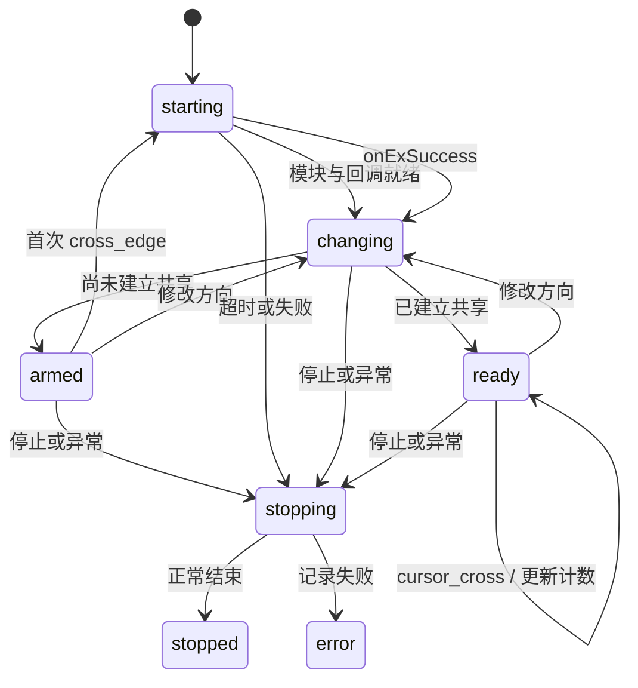

# 代码结构与执行链路

## 进程入口

`Launcher.cs` 是应用入口，负责加载运行资源、启动界面和调度后台模式；`Backend.cs` 实现连接查询与共享会话。

`Launcher.Main` 首先判断内部启动参数：

| 模式 | 入口 | 用途 |
| --- | --- | --- |
| 无内部模式参数 | `PrepareRuntime` → 启动 PowerShell | 正常界面 |
| `--backend <父 PID>` | `Backend.Share` | 共享会话 |
| `--connection-watch <父 PID>` | `Backend.Watch` | 基础连接查询 |
| `--connection-once` | `Backend.QueryConnection` | 单次查询，内部诊断用途；GUI EXE 不保证终端直接显示输出 |
| `--self-test` | `SelfTest` → `助手.ps1 -ValidateOnly` | 仅界面与左右布局自检 |
| `--start-sharing` | 正常界面，转交 `-StartSharing` | 界面首次渲染后请求启用共享 |
| `--fixture-*` | `Backend.Fixture` | 保留的离线测试桩，需 `OPPO_MOUSE_SHARING_FIXTURE=1` |

正常入口使用 `Local\OppoMouseSharingExe` 互斥锁。`PrepareRuntime` 计算内嵌 ZIP 的 SHA-256 前 16 位作为资源目录名，按明确的五文件白名单释放，写入 `complete` 标记。复用缓存时仅检查标记和文件存在性；资源摘要不等于缓存文件完整性校验或签名。

随后启动系统 `powershell.exe -NoProfile -STA -ExecutionPolicy Bypass -WindowStyle Hidden -File 助手.ps1` 并等待退出。启动器给子进程传入 `OPPO_MOUSE_SHARING_EXE` 和 `OPPO_MOUSE_SHARING_DATA`。若用户数据目录还没有设置，启动器可能从 EXE 同目录迁移一个小于 64 KiB 的 `settings.json`；不会迁移运行状态。

## 界面与连接查询

`助手.ps1` 只转入 `界面.ps1`。后者加载 `main.xaml`，建立 WPF 事件、WinForms NotifyIcon 托盘和第二层界面互斥锁。主窗口使用 `Application.Run()` 与 `OnMainWindowClose`，因此隐藏到托盘不会终止消息循环。

界面启动一个同 EXE 的 `--connection-watch <界面 PID>` 进程。`Backend.Watch` 在父进程存活期间循环调用 `QueryConnection`，每轮查询后等待 2 秒；单次请求超时为 1 秒。请求 `dspipc` 的 `/get_remote_device`，按业务状态 `0` 与 `device_id` 判断连接。输出只包含连接阶段、设备名称、连接方式、PID 和时间，不包含该接口返回的完整设备对象。

界面每 350 ms 读取 `connection.json`：校验 watcher PID，拒绝超过 7 秒或未来超过 2 秒的状态。共享状态文件也匹配当前共享后端 PID，防止上次运行的状态混入当前显示。

## 启用共享

`Toggle-Sharing` 保存偏好、移除旧停止请求，启动 `--backend <界面 PID>`。`Backend.Share` 依次执行：

1. 写入 `starting` 状态。
2. 从已安装客户端 `resources/app.asar` 读取 `package.json` 版本，将版本和是否为已验证的 `16.2.20` 写入状态文件；版本不匹配时继续运行，由界面显示一次兼容性提示。
3. 如果系统中已有名为 `screenshare` 的进程，拒绝启动，避免冲突。
4. 只读解析 `%APPDATA%\O+Connect\config.json`。以 `CurrentConnectedDevice` 匹配 `devicesList` 中设备 ID 的冒号前缀，读取设备信息和本机身份，验证手机地址为数字 IP。
5. 经 `dspipc /get_channel_local_ip` 获取电脑互联地址，组装共享参数。
6. 隐藏启动已安装的 `app_process/screenshare.exe 0`，等待其 `exipc` 可用，先关闭边缘触发。
7. 连接 `exevent`，写入 `ex_callback\r\n` 订阅，再按偏好启用单侧边缘，进入 `armed`。
8. 进入串行事件循环，消费事件队列、检查停止请求、父进程与原生进程存活、建连超时以及设备变化。

## 状态机与方向

界面处理当前后端的状态时，对未验证的客户端版本显示提示：“当前 OPPO 互联客户端版本适配性尚未确认，如遇到问题，请联系开发者或提交 Issue。”提醒记录按版本保存在 `settings.json` 的 `warnedClientVersions` 中，切换方向和关闭偏好时一并保留，重启后同一版本不重复提示。记录在弹窗前更新，防止模态窗口的定时器重入造成重复弹窗；保存记录失败时只影响跨次启动记忆，不阻止共享。

`SharingSession` 管理状态与 IPC 命令。后台读取事件后加入 `BlockingCollection`，主循环串行调用 `Event`，避免并发状态转换。



`cross_edge` 仅在 `!Sharing && !Connecting` 时调用 `/start_screen_sharing`，并设置 18 秒建连期限。`onExSuccess` 设置共享成功、清除连接中标记，稍后重新应用方向；`cursor_cross` 只增加穿越计数。`onExFailed`、`onExStopped`、`pipe_error` 结束会话。

| 手机位置 | location / screen_location | crossConnectSwitch |
| --- | --- | --- |
| 左侧 | 1 | 1 |
| 右侧 | 0 | 2 |
| 关闭边缘触发 | 不适用 | 3 |

切换方向时先关闭边缘触发；已共享时更新 `/change_screen_location`；再打开目标边缘。连接中暂缓方向变更，成功后读取最新偏好。该流程不主动停止或重建已成功的共享。

## 本机 IPC

`PipeHttp : IIpc` 用 `NamedPipeClientStream` 发送 HTTP/1.1 GET：

```text
GET /route?scope=1&params=<UTF-8 JSON 的 Base64> HTTP/1.1
Host: localhost
Connection: close
```

Base64 是编码，不是加密。HTTP 状态要求 `200`；业务成功码依接口而异。共享命令在 `SharingSession.Send` 检查存在的业务状态是否为 `200`；连接查询要求业务状态 `0`。`/get_channel_local_ip` 当前主要校验返回 IP，不应概括为所有路由都验证同一种业务码。

| 管道 | 路由 / 消息 | 用途 |
| --- | --- | --- |
| `dspipc` | `/get_remote_device` | 基础连接状态 |
| `dspipc` | `/get_channel_local_ip` | 电脑互联 IP |
| `exipc` | `/change_keymouse_cross_connect_switch` | 开关单侧边缘 |
| `exipc` | `/start_screen_sharing` | `mode: 0` 键鼠模式 |
| `exipc` | `/change_screen_location` | 设备相对位置 |
| `exipc` | `/stop_screen_sharing` | `mode: 0, reason: 1` |
| `exevent` | `ex_callback\r\n` | 订阅协同事件 |

启动共享参数字段：

```text
mode, screen_location, crossConnectSwitch,
remote_device_type, remote_device_name, remote_device_ip,
remote_device_id, connection_type,
local_device_type, local_device_id, local_device_name, local_ip
```

字段值来自当前设备配置和 IPC，不附任何真实示例身份。传输层支持 Content-Length、chunked 和读至流结束，限制响应体 16 MiB、响应头大小和请求时间。事件层使用 UTF-8 Decoder 处理跨包字符、换行或无换行的完整 JSON，并处理 `msg` 中嵌套 JSON；事件缓冲上限为 1 MiB。

这些是客户端内部接口，兼容性需实际验证，没有外部稳定 SDK 承诺。

## 数据文件与停止流程

| 文件 | 写入者 | 读取者 / 用途 |
| --- | --- | --- |
| `settings.json` | 界面 | 界面及共享后端；方向、关闭偏好与已提醒的客户端版本 |
| `connection.json` | 查询进程 | 界面；基础连接显示 |
| `state.json` | 共享后端 | 界面；阶段、消息、设备名、计数与 PID |
| `stop.request` | 界面 | 共享后端；请求停止 |
| `ui-error.log` | 界面 | 用户排查；可能包含本地路径 |

JSON 通过临时文件和替换操作写入。共享后端每次队列等待最多 250 ms，并约每 2 秒核对连接设备；IPC 等待期间整体响应时间可能更长。正常停止、父界面退出、原生进程退出、超时或设备变化都会进入清理：先发布 `stopping`，关闭边缘触发，尝试正常停止共享，关闭事件管道，必要时终止本次创建的原生进程，删除停止文件，发布 `stopped` 或 `error`。

界面“退出”在后端运行时先写停止请求，等待后端退出再关闭窗口；“最小化到托盘”继续运行。界面清理阶段停止定时器并释放托盘与查询进程。程序没有安装系统服务或开机启动任务。

## 验证边界

当前内置 `--self-test` 仅加载 WPF 并检查左右布局。`IIpc` 是可替换传输接口，`--fixture-*` 为测试桩，但原目录没有完整协议或托盘测试工程。本次开源副本不将历史测试描述等同于可复现的现有测试套件。停止恢复、多显示器、系统睡眠及其他机型需要另外设计和执行验证。
